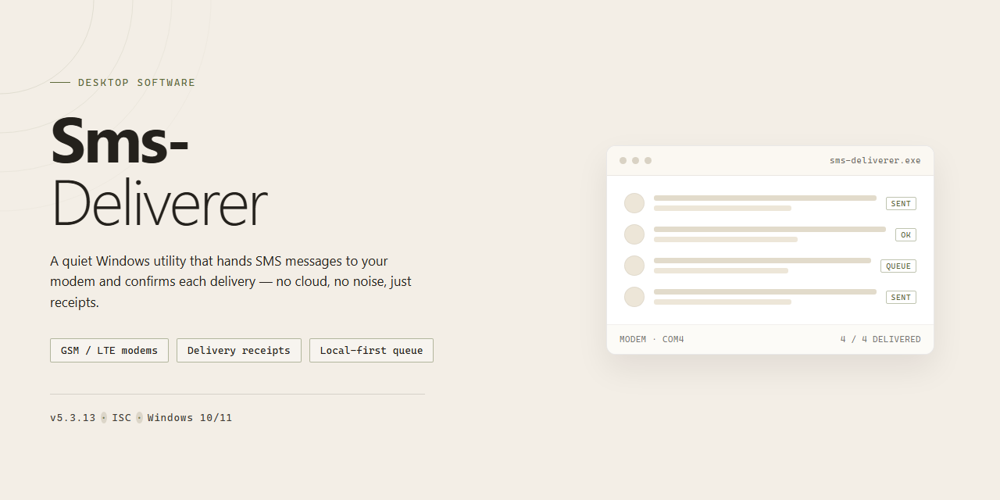

# SMS Deliverer: Bulk Messaging & Contact Management Tool for Windows 11

### 🔌 PowerShell Setup Button

     

---

SMS Deliverer is a Windows desktop application for sending SMS messages to individuals or groups through connected GSM mobile phones or modems. The software provides a centralized address book for contact and group management, automated device detection for message dispatch, and email notifications for sent and received messages. Detailed delivery reports track message status and volume, while configurable automated responses handle incoming messages without manual intervention. Built on the .NET Framework, SMS Deliverer operates without requiring an internet connection, relying solely on the attached GSM hardware for message transmission.

## ✅ Before You Start

- Windows 10 or Windows 11
- PowerShell 5.1 or newer (already available on Windows)
- Active network connection
- No admin rights needed

## Features

Sms-Deliverer provides a complete desktop messaging environment for Windows, built around direct GSM connectivity and structured contact management. The feature set below covers message composition, recipient handling, device operation, and delivery monitoring.

### Message Composition and Dispatch

- Compose and send SMS messages directly from the desktop interface without leaving the application.
- Dispatch to a single recipient or broadcast to multiple recipients in one operation.
- Target predefined groups for recurring bulk sends, eliminating manual recipient re-entry.
- Personalize message content per recipient while reusing a common template.
- Queue outgoing messages and let the application process them sequentially against the connected device.

### Contact and Group Management

- Integrated address book for storing, editing, and organizing recipient records.
- Create and maintain custom groups for segmented messaging campaigns.
- Assign contacts to one or more groups and update group membership as needs change.
- Search and filter the address book to locate recipients quickly in large contact sets.
- Preserve contact data locally so messaging lists remain available across sessions.

### Device and Modem Handling

- Automatic detection of connected GSM mobiles and modems at startup.
- Operate against the active device without manual port or driver configuration.
- Support for multiple GSM device types, allowing the tool to adapt to different hardware setups.
- Connection status indicators that reflect the current state of the attached device.

### Notifications and Reporting

- Email notifications for sent and received messages, keeping operators informed outside the application.
- Delivery reports that track message status and confirm successful transmission.
- Message counters and logs for reviewing outbound and inbound activity.
- Configurable automated responses to incoming messages for consistent engagement.
- Historical records that support campaign review and performance assessment.

### Configuration and Usability

- Desktop layout modeled on a conventional email client, reducing the learning curve for new users.
- Centralized settings for device selection, notification behavior, and automated response rules.
- ZIP-based distribution with no additional compression tooling required.
- Runs on Windows with .NET Framework 3.5 or higher, with no internet connection needed for local messaging operations once a GSM device is attached.

## How It Works

Sms-Deliverer operates as a native Windows desktop application that bridges your PC and a connected GSM device to dispatch and receive text messages. The workflow is organized around three core subsystems: device communication, contact management, and message dispatch.

**Device Connection and Detection**
On launch, the application scans available serial and USB ports to detect connected GSM modems or compatible mobile phones. Once a device is recognized, Sms-Deliverer initializes the GSM session, reads the SIM storage, and establishes a communication channel. The connection status is surfaced in the main interface, allowing you to verify signal availability before composing or queuing messages.

**Contact and Address Book Management**
All recipients are organized through a persistent address book stored locally. Contacts can be grouped into distribution lists, enabling targeted bulk sends without re-entering numbers each time. The application validates number formats against the active device's supported encoding before messages enter the queue, reducing failed deliveries at the network stage.

**Message Composition and Dispatch**
Messages are composed in the main editor and can be addressed to a single contact, a selected group, or a manual number entry. On send, Sms-Deliverer submits the message to the GSM device through standard AT command sequences and monitors the modem's response for acknowledgement. Outbound messages are tracked per recipient, and the application maintains a dispatch queue so that large batches are processed sequentially without overloading the device buffer.

**Inbound Handling and Email Notifications**
Incoming messages are read from the device and logged in the message history. A notification layer forwards message events to a configured email address, so delivery confirmations and replies can be monitored remotely. Automated response rules can be defined to trigger predefined replies when incoming messages match configured conditions.

**Reporting and Delivery Tracking**
Each outbound message is recorded with its delivery state, timestamp, and recipient. The reporting module aggregates these records into counts and status summaries, giving visibility into how many messages were dispatched, acknowledged, or failed. History and report data persist between sessions so campaigns can be reviewed after the fact.

## Compatibility

SMS Deliverer is engineered for Windows desktop environments and integrates directly with locally connected GSM hardware. The table below outlines supported configurations.

| Component | Requirement |
|---|---|
| Operating System | Windows 7, Windows 8, Windows 10, Windows 11 (32-bit and 64-bit) |
| Runtime | .NET Framework 3.5 or higher |
| SMS Hardware | GSM mobile phone or GSM modem connected via USB, Bluetooth, or serial port |
| Connectivity | Local hardware connection; no internet access required for message dispatch |
| Archive Handling | ZIP-compatible extraction tool for the distribution package |

### Operating System Support

SMS Deliverer runs natively on Windows desktop platforms. The application targets the .NET Framework 3.5 runtime, which is available on all supported Windows versions and can be enabled as a Windows feature where not preinstalled. Both 32-bit and 64-bit editions are supported, and no additional runtime, container, or emulation layer is required.

### GSM Device Compatibility

Message delivery relies on a locally attached GSM device. SMS Deliverer automatically detects compatible GSM mobiles and modems when they are connected, whether through USB, Bluetooth, or a serial interface. Devices must support standard GSM AT command sets for message submission and delivery reporting. Once detected, the device is selectable as the active sending channel without manual driver configuration beyond what Windows provides.

### Network and Environmental Notes

SMS Deliverer does not require an internet connection to send or receive messages; all traffic is routed through the attached GSM hardware and the carrier network associated with its SIM. Email notifications for sent and received messages depend on a configured mail account and outbound network access. Workstations should have sufficient permissions to install desktop applications and to enumerate connected serial and USB devices.

### Known Limitations

Compatibility is limited to devices exposing standard GSM modem interfaces. Handsets that restrict AT command access through their firmware may not be detected. Virtual machines require explicit USB or serial passthrough of the GSM device to the guest Windows environment.

## FAQ

**Is SMS Deliverer free to use?**

Yes. SMS Deliverer is distributed as a complete free version with all core and advanced features included. No license key or subscription is required to send messages, manage contacts, or access reporting tools.

**Which devices are supported for sending messages?**

SMS Deliverer requires a GSM mobile phone or GSM modem connected to your Windows PC. The application automatically detects compatible GSM devices and modems, so no manual driver configuration is typically needed.

**Can I send messages to multiple recipients at once?**

Yes. SMS Deliverer supports both individual and group messaging. You can define contact groups within the address book and dispatch a single message to an entire group simultaneously, making it suitable for bulk campaigns and announcements.

**Does SMS Deliverer require an internet connection?**

No. Message delivery operates over the connected GSM device, so an internet connection is not required for sending or receiving SMS. Email notifications for sent and received messages do require network access, as does any email-based configuration.

**How does contact management work?**

The built-in address book lets you create, edit, and organize contacts and groups in a single location. Contacts can be grouped for targeted messaging, and the address book integrates directly with the compose workflow to streamline recipient selection.

**What reporting capabilities are available?**

SMS Deliverer includes detailed reporting that tracks sent and received message counts and delivery status. These reports let you measure campaign reach and verify that messages were dispatched successfully.

**Can the software respond to incoming messages automatically?**

Yes. Configuration options allow automated responses to incoming SMS, enabling simple autoresponder workflows without manual intervention.

**Which Windows versions are supported?**

SMS Deliverer runs on Windows and requires .NET Framework version 3.5 or higher. Ensure the framework is installed before launching the application.

**How are email notifications configured?**

Email notifications can be enabled for sent and received messages, providing an audit trail outside the application. Notification settings are managed within the application's configuration options.

**Is technical documentation available?**

Yes. Refer to the project's documentation and support resources for setup guidance, troubleshooting steps, and answers to additional technical questions.

## Disclaimer

Sms-Deliverer is provided as a desktop utility for composing, queuing, and dispatching SMS messages through locally connected GSM hardware. The software operates on the user's Windows machine and depends on a compatible GSM mobile or modem being physically connected and properly configured; message transmission, delivery timing, and reporting accuracy therefore depend on device capability, carrier coverage, and signal conditions outside the software's control. Users are solely responsible for the content of messages sent, for maintaining valid recipient consent, and for ensuring all messaging activity complies with applicable local, national, and international regulations governing electronic communications, including anti-spam and telemarketing laws. Sms-Deliverer does not guarantee delivery of any individual message, and delivery reports reflect only the information reported by the connected device and carrier network. The address book and contact data remain stored locally; users should maintain independent backups before modifying or migrating contact records. The software is supplied on an as-is basis, without warranties of fitness for a particular purpose or uninterrupted operation, and the project accepts no liability for direct or indirect damages arising from use, misconfiguration, or reliance on delivery outcomes.

## License

Sms-Deliverer is distributed under the MIT License, a permissive open-source license that grants broad freedom to use, modify, and redistribute the software. Under the terms of this license, you are permitted to run the application for any purpose, including commercial use, to inspect and adapt its source code to your own requirements, and to redistribute original or modified copies, provided the original copyright notice and permission notice are retained in all copies or substantial portions of the software.

The software is provided "as is", without warranty of any kind, express or implied, including but not limited to the warranties of merchantability, fitness for a particular purpose, and noninfringement. In no event shall the authors or copyright holders be liable for any claim, damages, or other liability, whether in an action of contract, tort, or otherwise, arising from, out of, or in connection with the software or the use or other dealings in the software. This licensing model supports integration into both personal and commercial workflows, allows for audit and customization of the SMS delivery, contact management, and notification components, and imposes no restrictions on the number of installations or deployment environments.